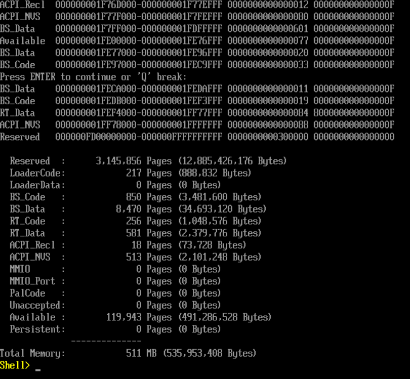
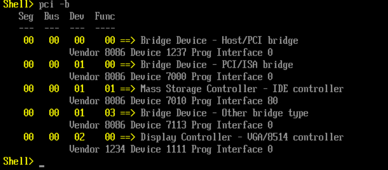
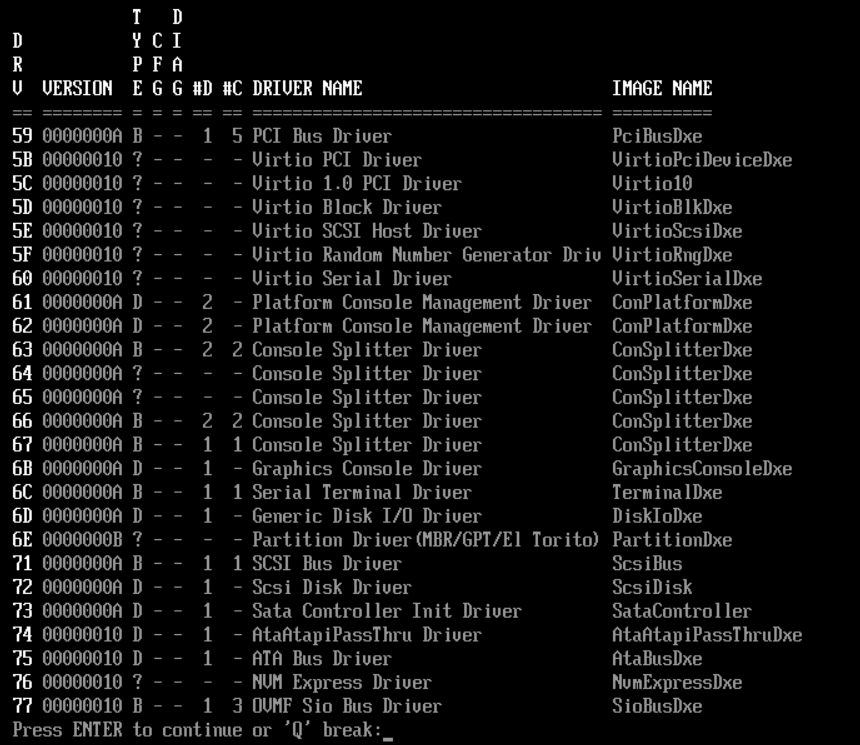
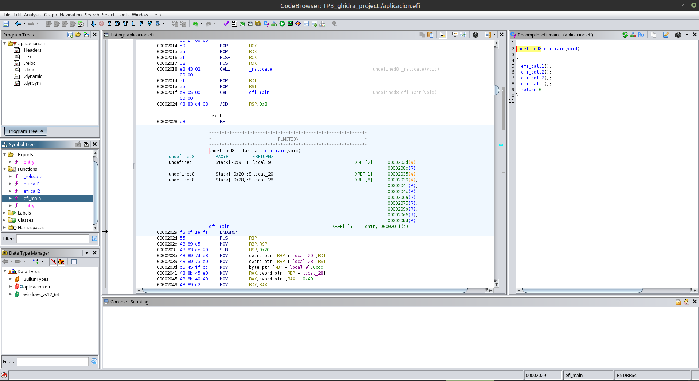
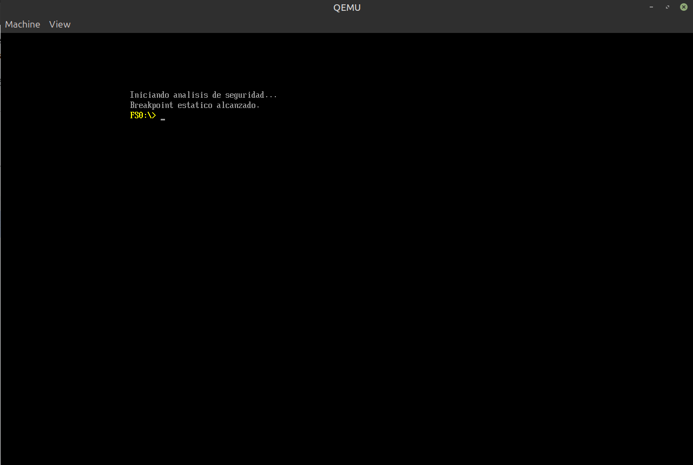
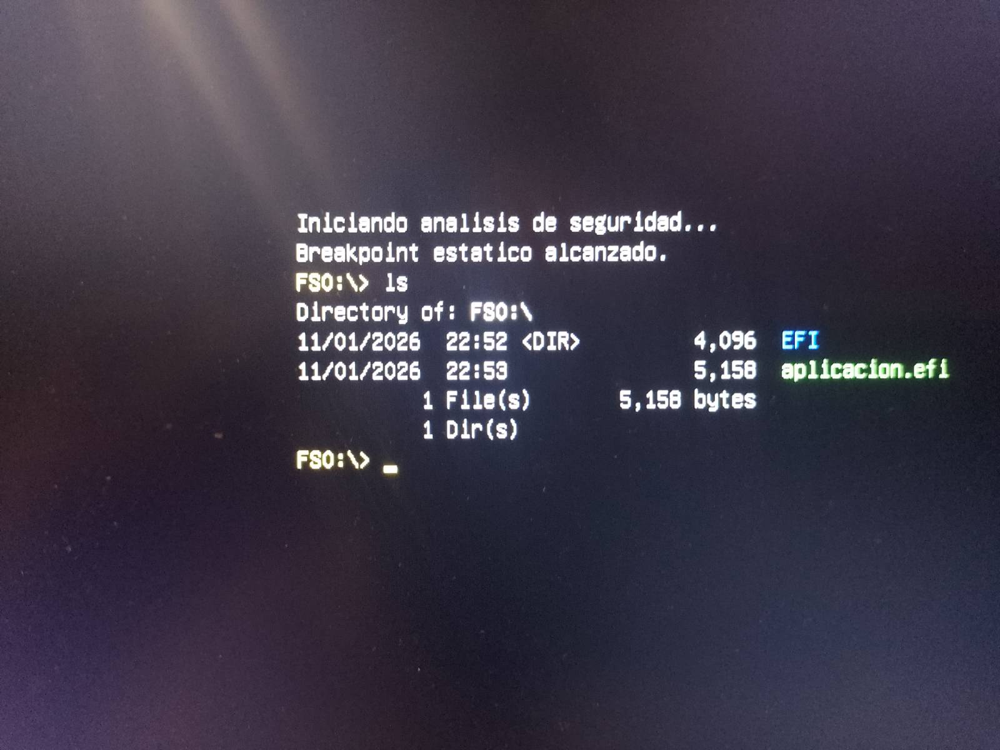

# TP3_SdC

## Integrantes del grupo

    - Abad Iñaki Manuel
    - Mensi Spachessi Valentín

## Descripción

El trabajo práctico consistió en interactuar con la arquitectura UEFI como un entorno pre-sistema operativo. Se dividió en tres partes: la exploración del entorno virtualizado, el desarrollo y análisis estático de un binario nativo UEFI en C, y finalmente la ejecución de dicho binario directamente sobre el hardware físico (bare metal) sorteando medidas de seguridad.

## Primera Parte — Exploración del entorno UEFI

Se preparó un entorno de laboratorio utilizando **QEMU** y el firmware abierto **OVMF**. A través de la UEFI Shell, se analizó cómo esta arquitectura abstrae el hardware utilizando *Handles* y *Protocolos*, lo que brinda mayor seguridad y compatibilidad frente a los puertos fijos del antiguo BIOS Legacy.

Se exploró la NVRAM interactuando con variables globales como `BootOrder` (la cual define la secuencia de arranque) y se inyectó exitosamente una variable de prueba (`TestSeguridad`). Además, se realizó el footprinting del sistema volcando el mapa de memoria y la lista de dispositivos PCI. En el mapa de memoria se identificaron regiones `RuntimeServicesCode`, las cuales no se borran al cargar el sistema operativo y son objetivos clave para inyectar bootkits persistentes.

A continuación, algunas capturas del proceso de exploración:

Listado de identificadores y protocolos en lugar de direcciones físicas fijas.

Inyección de una variable en el entorno no volátil.

Variables predefinidas por el firmware.

Zonas de memoria, incluyendo los Runtime Services.

Listado de hardware PCI detectado.

Drivers cargados en el entorno pre-OS.

## Segunda Parte — Desarrollo y Análisis en C

En esta fase se desarrolló una aplicación en C nativa para UEFI. Dado que se trata de un entorno *freestanding* sin librerías estándar (como libc), se debió utilizar el protocolo `ConOut` (`SystemTable->ConOut->OutputString`) del firmware para poder imprimir texto en pantalla en lugar de un `printf` convencional. El código fue compilado al formato PE/COFF de Windows (`aplicacion.efi`).

El binario incluyó una instrucción de breakpoint estático (`0xCC`). Al analizar el archivo resultante con el descompilador **Ghidra**, se observó cómo este traduce las rutinas UEFI a llamadas genéricas por falta de firmas, e interpreta por defecto el valor `0xCC` como el entero con signo `-52` (opcode crítico en ciberseguridad utilizado para anti-debugging y hooks).

Finalmente, el binario fue cargado y ejecutado exitosamente dentro del emulador QEMU.

Traducción del ensamblador al pseudocódigo en Ghidra, visualizando la inicialización del byte `0xcc`.

El breakpoint es evaluado correctamente de forma dinámica.

## Tercera Parte — Ejecución en Hardware Real

Para la última iteración, se preparó un pendrive en formato `FAT32` con la estructura estandarizada `/EFI/BOOT/BOOTX64.EFI` (conteniendo la UEFI Shell oficial) y el binario desarrollado.

Se configuró la BIOS de una notebook Haier, de tal forma que se **desactivó el Secure Boot**. Este paso fue obligatorio, ya que los binarios generados no poseían una firma criptográfica autorizada y hubieran sido rechazados por el sistema de validación del hardware.

La aplicación se ejecutó exitosamente de forma directa sobre la placa base, sin ningún sistema operativo subyacente.

Salida de la aplicación en la pantalla de la notebook

## Tecnologías utilizadas

- C
- Assembly x86-64
- GNU-EFI / TianoCore
- QEMU / OVMF
- Ghidra
- GCC